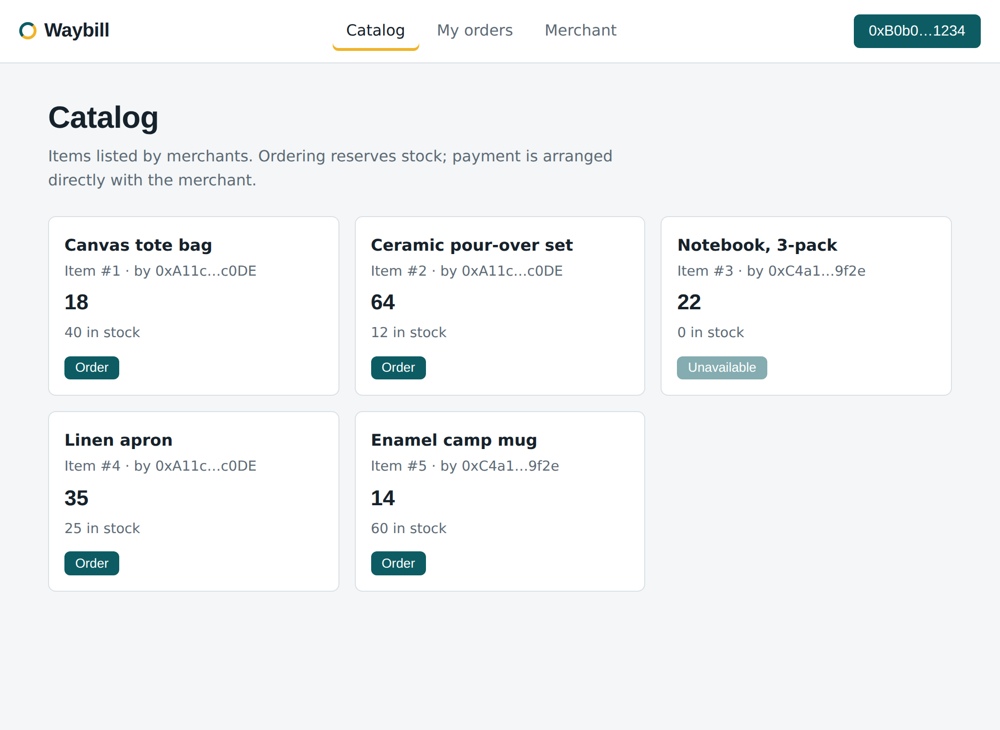
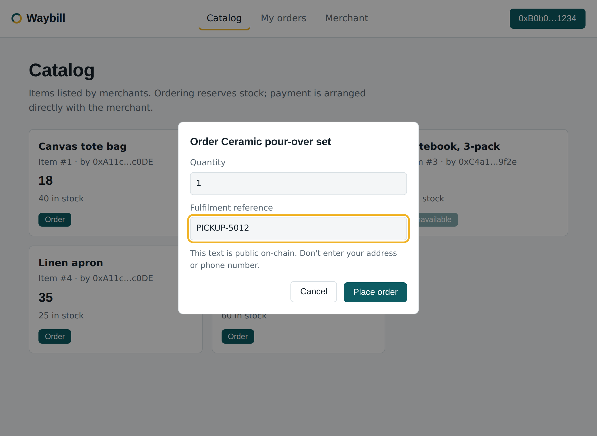
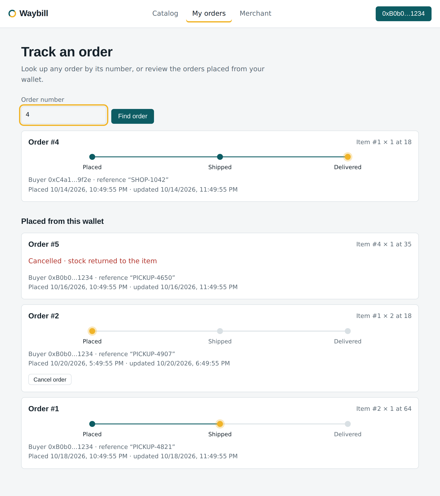
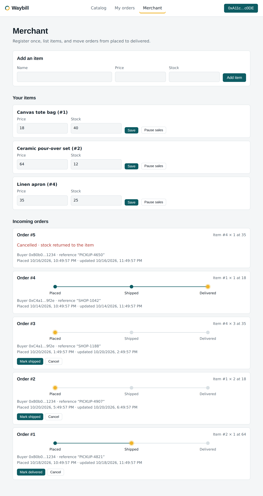
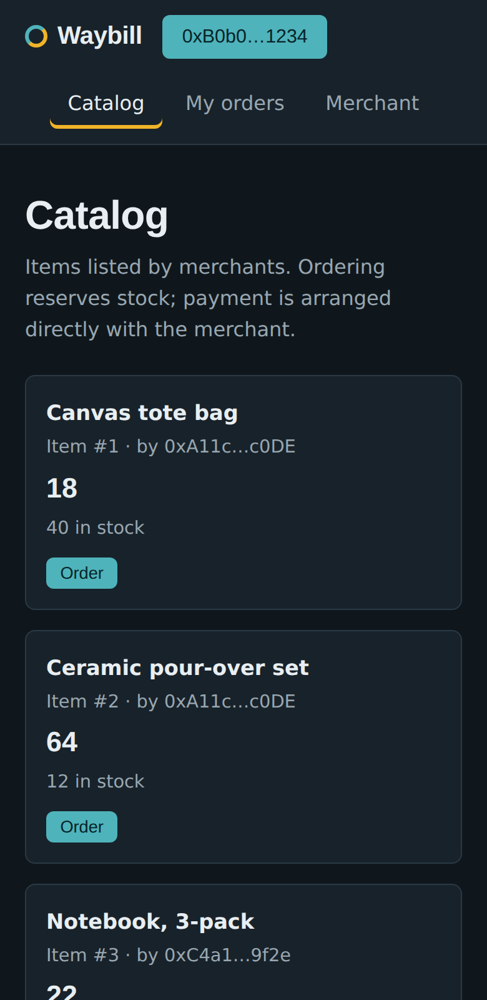

# Waybill

Order tracking on Ethereum. Merchants list items, buyers place orders, and every
status change is written to the chain, so anyone with an order number can verify
where an order stands.

Waybill is intentionally small: one contract, one static web page, no build step.
It's a good base for a delivery, booking or fulfilment flow that needs a shared,
tamper-evident record.

## What it does

- **Merchants** register once, list items with a price and stock, edit them, and pause sales.
- **Buyers** browse the catalog and place an order. Stock is reserved immediately.
- **Everyone** can look up an order by number and see its progress.
- **Status flow** is enforced by the contract:

```
Placed ──► Shipped ──► Delivered
   │          │
   └──────────┴──► Cancelled   (stock is returned exactly once)
```

| Who | Allowed |
|---|---|
| Merchant | Placed → Shipped, Shipped → Delivered, Placed/Shipped → Cancelled |
| Buyer | Placed → Cancelled |

No funds pass through the contract. Price is informational and settlement
happens between the parties.

## Screenshots

Captured from the web UI with sample data.

| Browse the catalog | Place an order |
|---|---|
|  |  |

| Track an order | Merchant dashboard |
|---|---|
|  |  |

<p align="center"></p>

## Project layout

```
contracts/Waybill.sol   the contract
test/                   Hardhat tests
scripts/deploy.js       deployment script
web/                    static frontend (ethers.js from a CDN)
docs/screenshots/       images used in this README
```

## Run it

Requires Node.js 18+ and a browser wallet such as MetaMask.

```bash
npm install
npm test                      # run the contract tests
```

Deploy to Sepolia:

```bash
export SEPOLIA_RPC_URL="https://..."     # your RPC endpoint
export DEPLOYER_KEY="0x..."              # a throwaway test key
npm run deploy:sepolia
```

Copy the printed address into `web/config.js`, then serve the UI:

```bash
npm run serve                 # http://localhost:8080
```

You can also paste `contracts/Waybill.sol` into Remix and deploy from there.

## Design notes

- Quantities and prices are `uint256` and validated; zero or oversized orders revert
- Custom errors and events on every state change, so indexers and UIs can follow along
- Order lists are indexed per buyer and per merchant, and the catalog is read in pages,
  so the UI never scans the whole chain state.
- The frontend builds the DOM with `textContent`, so on-chain strings can't inject markup
- `ref` on an order is public. Use an order code or an off-chain pointer, never personal data

## License

MIT, see [LICENSE](LICENSE).
